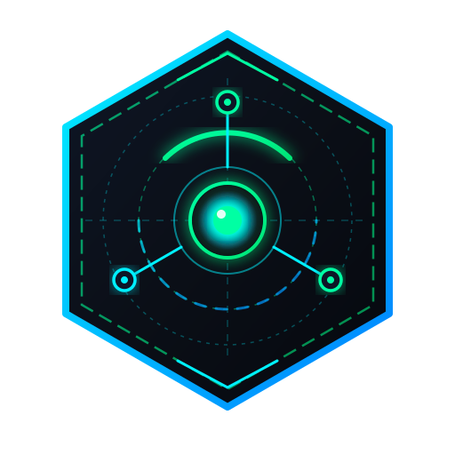

<div align="center">



# Antigravity ROS 2 Robotics Plugin
### `antigravity-robotics-plugin` • v1.2.0

**Native Antigravity Plugin, Model Context Protocol (MCP) Server & Zero-G Aerospace Suite for ROS 2 Autonomous Robotics**

[](https://github.com/EngineerAbdullahBinZafar/antigravity-robotics-plugin)
[-00FFA3?style=for-the-badge&logo=pytest&logoColor=black)](tests/)
[](ros2_mcp/sandbox.py)
[](ros2_packages/)
[](LICENSE)
[](pyproject.toml)

<br/>

*Engineered by **[Abdullah Bin Zafar](https://github.com/EngineerAbdullahBinZafar)** — Lead Robotics & Autonomous Systems Architect*

</div>

---

## 🌟 Overview

`antigravity-robotics-plugin` is an enterprise-grade, native **Google Antigravity Plugin**, **Model Context Protocol (MCP)** server, and **Aerospace Zero-G Control Suite** engineered to connect autonomous AI agents directly to **ROS 2 (Robot Operating System 2)** environments, digital twin simulations, and physical robotic hardware.

It empowers Antigravity agents to inspect topics, tune PID control loops, stream 2D LiDAR pointclouds, monitor multi-robot fleets, and execute safe actuator commands protected by a cryptographic and mutex-guarded **3-Tier Command Sandbox**.

### 🌌 Complete Multi-Layer Robotics Architecture:
1. **AI-Agentic Mission Supervisor (Python MCP)**: 16 high-level MCP tools for automated diagnosis, safety checks, and telemetry control.
2. **Interactive Zero-G Web Dashboard Sidecar**: 4-tab aerospace control station docking right inside the Antigravity IDE Aux Pane (`sidecar://antigravity-robotics-plugin/dashboard/index.html`).
3. **C++ Lifecycle Node (`antigravity_core`)**: Mission-critical deterministic FSM (`Unconfigured` ➡️ `Configuring` ➡️ `Inactive` ➡️ `Active` ➡️ `Finalized`) with a 250ms hardware watchdog.
4. **Native RViz2 Qt Panel Plugin (`antigravity_rviz_panel`)**: Desktop companion panel embedding Zero-G velocity gauges and E-STOP directly into desktop RViz2.
5. **Gazebo Harmonic Zero-G Simulation (`sim/`)**: Orbital microgravity world with 6-DOF thruster dynamics, celestial lighting, and obstacle docking courses.

---

## 🏗️ Architectural Topology

```text
┌────────────────────────────────────────────────────────────────────────┐
│                        Google Antigravity IDE                          │
│                                                                        │
│   ┌───────────────────────────┐      ┌──────────────────────────────┐  │
│   │    Agentic Reasoning      │      │    Interactive Web Dashboard │  │
│   │   (Tools / Prompts / MCP) │      │     (Aux Pane Native Sidecar)│  │
│   └─────────────┬─────────────┘      └──────────────▲───────────────┘  │
│                 │ stdio (JSON-RPC)                  │ SSE / WS (20Hz)  │
└─────────────────┼───────────────────────────────────┼──────────────────┘
                  ▼                                   │
┌─────────────────────────────────────────────────────┴──────────────────┐
│              antigravity-robotics-plugin (Native MCP Host)              │
│                                                                        │
│   ┌────────────────────────────────────────────────────────────────┐   │
│   │                 3-Tier Command Sandbox Guard                   │   │
│   │      [read_only]   |   [safe_write] (Default)   |   [full]     │   │
│   └────────────────────────────────┬───────────────────────────────┘   │
│                                    │ Safe Tool Invocation              │
│                                    ▼                                   │
│   ┌────────────────────────────────────────────────────────────────┐   │
│   │             16 MCP Tools across 8 Robotics Domains             │   │
│   │  Topics • Nodes • Params • Diagnostics • PID • Trajectory •    │   │
│   │             Spatial LiDAR • Swarm Fleet Management             │   │
│   └────────────────────────────────┬───────────────────────────────┘   │
│                                    │                                   │
│                  ┌─────────────────┴─────────────────┐                 │
│                  ▼                                   ▼                 │
│      ┌────────────────────────┐         ┌────────────────────────┐     │
│      │  ROS2NativeInterface   │         │     MockInterface      │     │
│      │  (rclpy / Hardware)    │         │  (Deterministic Sim)   │     │
│      └───────────┬────────────┘         └────────────────────────┘     │
└──────────────────┼─────────────────────────────────────────────────────┘
                   ▼
┌────────────────────────────────────────────────────────────────────────┐
│                   ROS 2 Ecosystem & Physical Actuators                 │
│                                                                        │
│   ┌───────────────────────────┐         ┌───────────────────────────┐  │
│   │ antigravity_core          │         │ antigravity_rviz_panel    │  │
│   │ (C++ Lifecycle Controller)│         │ (Native RViz2 Qt Panel)   │  │
│   └─────────────┬─────────────┘         └─────────────▲─────────────┘  │
│                 │ /cmd_vel /antigravity/thrust_cmd    │                │
│                 ▼                                     │                │
│   ┌───────────────────────────────────────────────────┴─────────────┐  │
│   │            Gazebo Harmonic Zero-G / Hardware Actuators          │  │
│   │            (6-DOF Thrusters, 360° LiDAR, High-G IMU)            │  │
│   └─────────────────────────────────────────────────────────────────┘  │
└────────────────────────────────────────────────────────────────────────┘
```

---

## 🎨 Zero-G Aerospace Color Palette & Ergonomics

Designed specifically for harsh lighting fluctuations, polarized visors, and high-vibration aerospace operations (>7:1 WCAG AAA Contrast):

| Role / Element | Palette Token | Hex Code | Functional Intent & Ergonomics |
| :--- | :--- | :--- | :--- |
| **Main Surface** | Deep Space Charcoal | `#12131C` | Absorbs screen glare, minimizes eye fatigue in zero-g environments. |
| **Card / Panel** | Command Module Slate | `#2A2F42` | Clean structural separation of telemetry widgets without harsh white borders. |
| **Nominal Active**| Neon Cyan | `#00F0FF` | Confirms nominal field telemetry, active joint controllers, and clear path corridors. |
| **Caution / Alert**| Inertial Amber | `#FFB800` | Joint limits, proximity thresholds (0.6m - 1.5m), and transient FSM states. |
| **Critical Alarm**| Solar Flare Red | `#FF3366` | Emergency Stop (E-STOP) and obstacle proximity (Protanopia-safe coral red). |
| **Typography** | Vibration-Proof Silver | `#E2E8F0` | High-readability silver-white eliminating halo effects under thruster vibration. |

---

## 🛡️ 3-Tier Security Sandbox Guardrails

To prevent unintended actuation or dangerous physical hardware movement, all tool executions pass through the **Command Sandbox**:

| Sandbox Level | Permitted Operations | Guardrail Enforcement |
| :--- | :--- | :--- |
| `read_only` | `ping`, `system_diagnostics`, `list_topics`, `read_topic`, `list_nodes`, `get_node_info`, `get_parameter`, `get_pid_state`, `get_robot_snapshot`, `get_spatial_map`, `swarm_fleet_status` | **Zero hardware writes.** All `publish_topic`, `set_parameter`, and `tune_pid` calls are rejected with `SandboxBlockedError`. |
| `safe_write` *(Default)* | All read operations + strictly allowlisted topics (`/cmd_vel`, `/target_velocity`, `/led_state`, `/speaker_cmd`, `/arm_target_angle`) and parameters (`max_vel_x`, etc.) | Any attempt to publish to unauthorized topics or change unverified parameters is audited and rejected. |
| `full` | Unrestricted read/write access across all ROS 2 nodes and topics | Permitted **only** in simulation mode (`MockInterface`) or on verified isolated test benches. |

---

## 🧰 16 Standard Robotics Tools

| Domain | Tool Name | Description | Default Level |
| :--- | :--- | :--- | :--- |
| **System** | `ping` | Ping ROS 2 daemon and verify connection health | `read_only` |
| **System** | `system_diagnostics` | Full health diagnostics (battery, sensors, CPU, memory, errors) | `read_only` |
| **Topics** | `list_topics` | Discover all active ROS 2 topics and message types | `read_only` |
| **Topics** | `read_topic` | Read latest message payload from any ROS 2 topic | `read_only` |
| **Topics** | `publish_topic` | Publish command payloads to topics (e.g. `/cmd_vel`) | `safe_write` |
| **Nodes** | `list_nodes` | Inspect active ROS 2 computational graph nodes | `read_only` |
| **Nodes** | `get_node_info` | Query node publishers, subscribers, services, and actions | `read_only` |
| **Parameters** | `get_parameter` | Read parameter values from any ROS 2 node | `read_only` |
| **Parameters** | `set_parameter` | Safely update ROS 2 node configuration parameters | `safe_write` |
| **State** | `get_robot_snapshot` | Instant multi-sensor telemetry state aggregation | `read_only` |
| **Control** | `get_pid_state` | Retrieve current PID loop gains ($K_p$, $K_i$, $K_d$) | `read_only` |
| **Control** | `tune_pid` | Dynamically calibrate axis controller gains ($K \ge 0$) | `safe_write` |
| **Kinematics**| `predict_trajectory` | Simulate future kinematic motion profile ($x, y, \theta$) | `read_only` |
| **Safety** | `predictive_safety_check`| Time-to-collision (TTC) & obstacle proximity verification | `read_only` |
| **Perception**| `get_spatial_map` | 2D/3D spatial occupancy grid & LiDAR pointcloud array | `read_only` |
| **Fleet** | `swarm_fleet_status` | Multi-robot telemetry monitoring & formation status | `read_only` |

---

## 🖥️ Interactive Web Dashboard & Sidecar

The plugin features a zero-dependency, zero-CDN **Aerospace Web Dashboard** engineered for high-contrast visibility and responsive real-time control:

* **Tactile Drive & Radar (Tab 1):** Clickable D-pad with keyboard arrows (`↑ ↓ ← →` and `Space`), speed profiles (0.2, 0.5, 1.0 m/s), and real-time 360° Canvas LiDAR radar with geometric orientation-agnostic badges (`🔺 Obstacle Close`, `🔷 Path Clear`).
* **Sensors & Health (Tab 2):** Live battery voltage/amperage progress bar, 3D IMU artificial horizon, and diagnostic alerts.
* **Engineer Mode (Tab 3):** Real-time ROS 2 computational graph node monitor, topic search/inspection modal, and dynamic PID gain calibration sliders.
* **Activity Log (Tab 4):** Live timestamped event and audit log stream.
* **Antigravity Aux Pane Native Link:**
  ```markdown
  [ROS 2 Robotics Dashboard](sidecar://antigravity-robotics-plugin/dashboard/index.html)
  ```

---

## 🚀 Quick Start & Usage

### 1. Installation
Install directly in your Python environment or Antigravity workspace:

```bash
git clone https://github.com/EngineerAbdullahBinZafar/antigravity-robotics-plugin.git
cd antigravity-robotics-plugin
pip install -e ".[dev,dashboard,rosbridge]"
```

### 2. Building ROS 2 C++ Packages (Humble / Jazzy)
```bash
# In your ROS 2 colcon workspace:
mkdir -p ~/ros2_ws/src
cp -r ros2_packages/* ~/ros2_ws/src/
cd ~/ros2_ws
colcon build --symlink-install
source install/setup.bash
```

### 3. Launch Gazebo Harmonic Zero-G Simulation
```bash
ros2 launch sim/launch/zero_g_simulation.launch.py
```

### 4. Launch Standalone Dashboard
```bash
python -m ros2_mcp.dashboard.server --port 8765
# Or via CLI alias:
ros2-mcp-dashboard --port 8765
```

### 5. Run Automated Test Suite
Execute the comprehensive 152-test verification suite:

```bash
pytest tests/ -v
```

---

## 🧪 Verification & Benchmarks

The entire test suite executes with **100% success rate (152/152 passing)** across 8 specialized verification harnesses:

* `test_plugin_manifest.py`: Validates `plugin.json`, `mcp_config.json`, assets, and Antigravity schema compliance.
* `test_server.py`: Validates all 16 tool handlers, parameter validation, and JSON-RPC hygiene.
* `test_dashboard_api.py`: Validates REST API endpoints, topic routing, and telemetry streams.
* `test_live_ws_stress_m2.py`: Real-time stress tests verifying 20Hz sustained streaming across concurrent clients.
* `test_adversarial_m1.py` & `test_adversarial_m2.py`: Adversarial safety penetration tests, ungraceful socket teardowns, and directory traversal immunity.
* `test_adversarial_stress_m2.py`: Concurrency and rapid connect/disconnect churn tests.
* `test_empirical_benchmarks.py`: P95 latency benchmarks (<30ms connect latency, <5ms command dispatch).

---

## 📁 Repository Structure

```text
antigravity-robotics-plugin/
├── plugin.json                    # Antigravity native plugin manifest
├── mcp_config.json                # MCP stdio client configuration
├── pyproject.toml                 # Modern PEP 621 build configuration
├── setup.py                       # Setuptools packaging specification
├── LICENSE                        # Apache 2.0 Open Source License
├── README.md                      # Complete system documentation
├── assets/
│   └── logo.svg                   # Vector logo badge
├── rules/
│   └── AGENTS.md                  # Priority directives & sidecar link rules
├── skills/
│   └── ros2-robotics/
│       └── SKILL.md               # Antigravity skill specification
├── sidecars/
│   └── dashboard/
│       ├── sidecar.json           # Aux pane sidecar configuration
│       └── launch.py              # Robust sidecar launcher
├── ros2_mcp/
│   ├── server.py                  # Core MCP server & JSON-RPC stdio transport
│   ├── ros2_interface.py          # Dual runtime (ROS2NativeInterface & MockInterface)
│   ├── sandbox.py                 # 3-tier security sandbox & mutex audit log
│   ├── tools/                     # 16 modular tool implementations
│   └── dashboard/
│       ├── server.py              # Asynchronous HTTP/SSE/WebSocket streaming server
│       └── static/
│           ├── index.html         # 4-tab semantic HTML5 dashboard interface
│           ├── style.css          # Zero-G aerospace dark theme
│           └── app.js             # 360° LiDAR radar, tactile D-Pad, & telemetry
├── ros2_packages/
│   ├── antigravity_core/          # C++ rclcpp_lifecycle::LifecycleNode package
│   └── antigravity_rviz_panel/    # Native C++/Qt rviz_common::Panel plugin
├── sim/
│   ├── worlds/zero_g_orbit.sdf    # Gazebo Harmonic zero-gravity world
│   ├── models/                    # 6-DOF craft model with thrusters & LiDAR
│   └── launch/                    # ROS 2 Gazebo simulation launch pipeline
└── tests/                         # 152 passing automated tests
```

---

## 📄 License & Attribution

This project is open-source software licensed under the **[Apache License 2.0](LICENSE)**.

Developed and maintained by **[Abdullah Bin Zafar](https://github.com/EngineerAbdullahBinZafar)**.  
Contributions, bug reports, and pull requests are welcome!
