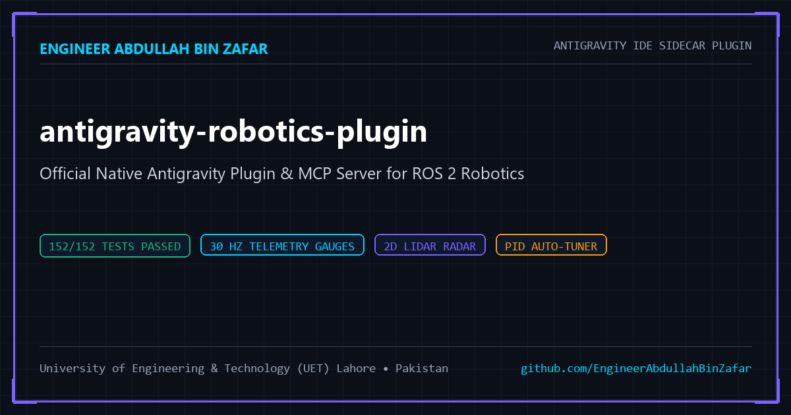
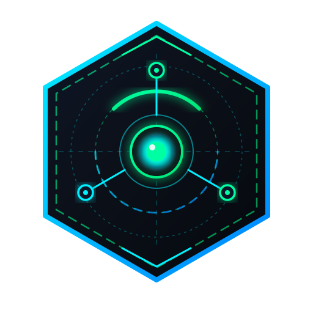

<div align="center">

<p align="center">
  
</p>



# Antigravity ROS 2 Robotics Plugin
### `antigravity-robotics-plugin` • v1.2.0

**Native Antigravity Plugin, Model Context Protocol (MCP) Server & Zero-G Aerospace Suite for ROS 2 Autonomous Robotics**

[](https://github.com/EngineerAbdullahBinZafar/antigravity-robotics-plugin/actions/workflows/ci.yml)
[](https://github.com/EngineerAbdullahBinZafar/antigravity-robotics-plugin)
[-00FFA3?style=for-the-badge&logo=pytest&logoColor=black)](tests/)
[](ros2_mcp/sandbox.py)
[](ros2_packages/)
[](LICENSE)
[](pyproject.toml)

<br/>

*Engineered by **[Abdullah Bin Zafar](https://github.com/EngineerAbdullahBinZafar)** — Lead Robotics & Autonomous Systems Architect*

</div>

---

## 🌟 Overview

`antigravity-robotics-plugin` is an enterprise-grade, native **Google Antigravity Plugin**, **Model Context Protocol (MCP)** server, and **Aerospace Zero-G Control Suite** engineered to connect autonomous AI agents directly to **ROS 2 (Robot Operating System 2)** environments, digital twin simulations, and physical robotic hardware across terrestrial and microgravity platforms.

It empowers Antigravity agents to inspect topics, tune PID control loops, stream 2D LiDAR pointclouds, monitor multi-robot fleets, and execute safe actuator commands protected by a mutex-guarded **3-Tier Command Sandbox**.

### 🌌 Complete Multi-Layer Robotics Architecture:
1. **AI-Agentic Mission Supervisor (Python MCP)**: 16 high-level MCP tools for automated diagnosis, safety checks, and telemetry control.
2. **Interactive Zero-G Web Dashboard Sidecar**: 4-tab aerospace control station docking right inside the Antigravity IDE Aux Pane (`sidecar://antigravity-robotics-plugin/dashboard/index.html`).
3. **C++ Lifecycle Node (`antigravity_core`)**: Mission-critical deterministic FSM (`Unconfigured` ➡️ `Inactive` ➡️ `Active` ➡️ `Finalized`) with a 250ms hardware watchdog.
4. **Native RViz2 Qt Panel Plugin (`antigravity_rviz_panel`)**: Desktop companion panel embedding Zero-G velocity gauges and E-STOP directly into desktop RViz2.
5. **Gazebo Harmonic Zero-G Simulation (`sim/`)**: Orbital microgravity world with 6-DOF thruster dynamics, celestial lighting, and obstacle docking courses.

---

## 🏗️ Architectural Topology

```text
┌────────────────────────────────────────────────────────────────────────┐
│                        Google Antigravity IDE                          │
│                                                                        │
│   ┌───────────────────────────┐      ┌──────────────────────────────┐  │
│   │    Agentic Reasoning      │      │    Interactive Web Dashboard │  │
│   │   (Tools / Prompts / MCP) │      │     (Aux Pane Native Sidecar)│  │
│   └─────────────┬─────────────┘      └──────────────▲───────────────┘  │
│                 │ stdio (JSON-RPC 2.0)              │ SSE / WS (20-30Hz)│
└─────────────────┼───────────────────────────────────┼──────────────────┘
                  ▼                                   │
┌─────────────────────────────────────────────────────┴──────────────────┐
│              antigravity-robotics-plugin (Native MCP Host)              │
│                                                                        │
│   ┌────────────────────────────────────────────────────────────────┐   │
│   │                 3-Tier Command Sandbox Guard                   │   │
│   │      [read_only]   |   [safe_write] (Default)   |   [full]     │   │
│   │             Mutex-guarded Audit Logger (threading.Lock)        │   │
│   └────────────────────────────────┬───────────────────────────────┘   │
│                                    │ Safe Tool Invocation              │
│                                    ▼                                   │
│   ┌────────────────────────────────────────────────────────────────┐   │
│   │             16 MCP Tools across 8 Robotics Domains             │   │
│   │  Topics • Nodes • Params • Diagnostics • PID • Trajectory •    │   │
│   │             Spatial LiDAR • Swarm Fleet Management             │   │
│   └────────────────────────────────┬───────────────────────────────┘   │
│                                    │                                   │
│                  ┌─────────────────┴─────────────────┐                 │
│                  ▼                                   ▼                 │
│      ┌────────────────────────┐         ┌────────────────────────┐     │
│      │  ROS2NativeInterface   │         │     MockInterface      │     │
│      │  (rclpy / Hardware)    │         │  (Deterministic Sim)   │     │
│      └───────────┬────────────┘         └────────────────────────┘     │
└──────────────────┼─────────────────────────────────────────────────────┘
                   ▼
┌────────────────────────────────────────────────────────────────────────┐
│                   ROS 2 Ecosystem & Physical Actuators                 │
│                                                                        │
│   ┌───────────────────────────┐         ┌───────────────────────────┐  │
│   │ antigravity_core          │         │ antigravity_rviz_panel    │  │
│   │ (C++ Lifecycle Controller)│         │ (Native RViz2 Qt Panel)   │  │
│   │ 250ms Watchdog & FSM      │         │ Zero-G Gauges & E-STOP    │  │
│   └─────────────┬─────────────┘         └─────────────▲─────────────┘  │
│                 │ /antigravity/thrust_cmd             │ /cmd_vel       │
│                 ▼                                     │                │
│   ┌───────────────────────────────────────────────────┴─────────────┐  │
│   │            Gazebo Harmonic Zero-G / Hardware Actuators          │  │
│   │            (6-DOF Thrusters, 360° LiDAR, High-G IMU)            │  │
│   └─────────────────────────────────────────────────────────────────┘  │
└────────────────────────────────────────────────────────────────────────┘
```

---

## 🎨 Zero-G Aerospace Color Palette & Ergonomics

Designed specifically for harsh lighting fluctuations, polarized visors, and high-vibration aerospace operations ($>7:1$ WCAG AAA Contrast Ratio):

| Role / Element | Token Name | Hex Code | Visual & Ergonomic Intent |
| :--- | :--- | :--- | :--- |
| **Main Surface** | Deep Space Charcoal | `#12131C` | Absorbs screen glare, minimizes eye strain under direct celestial glare |
| **Panel Surface**| Command Module Slate| `#1A1D29` | Structural separation of telemetry widgets without harsh white borders |
| **Card Border** | Avionics Frame | `#2A2F42` | High-definition card containment and structural contrast |
| **Nominal Active**| Neon Cyan | `#00F0FF` | Active feedback, nominal topic streaming, clear navigation corridors |
| **Caution / Alert**| Inertial Amber | `#FFB800` | Proximity alerts ($0.6\,\text{m}$–$1.5\,\text{m}$), gain limits, transient FSM states |
| **Critical Alarm**| Solar Flare Red | `#FF3366` | Emergency Stop (E-STOP), physical collision bounds, protanopia-safe |
| **Typography** | Vibration-Proof Silver | `#E2E8F0` | High-legibility silver-white eliminating blur under thruster vibrations |

---

## 🛡️ 3-Tier Security Sandbox Guardrails

To prevent unintended actuation or dangerous physical hardware movement, all tool executions pass through the **Command Sandbox**:

| Sandbox Level | Permitted Operations | Guardrail Enforcement |
| :--- | :--- | :--- |
| `read_only` | `ping`, `system_diagnostics`, `list_topics`, `read_topic`, `list_nodes`, `get_node_info`, `get_parameter`, `get_pid_state`, `get_robot_snapshot`, `get_spatial_map`, `swarm_fleet_status` | **Zero hardware writes.** All `publish_topic`, `set_parameter`, and `tune_pid` calls are rejected with `SandboxBlockedError`. |
| `safe_write` *(Default)* | All read operations + strictly allowlisted topics (`/cmd_vel`, `/target_velocity`, `/led_state`, `/speaker_cmd`, `/arm_target_angle`) and parameters (`nav2_controller:max_vel_x`, etc.) | Any attempt to publish to unauthorized topics or change unverified parameters is audited and rejected via a thread-safe mutex audit logger (`threading.Lock`). |
| `full` | Unrestricted read/write access across all ROS 2 nodes and topics | Permitted **only** in simulation mode (`MockInterface`) or on verified isolated test benches. |

---

## 🧰 16 Standard Robotics Tools & JSON-RPC Schemas

The plugin registers 16 deterministic MCP tools matching the 2024-11-05 Model Context Protocol specification:

| # | Domain | Tool Name | Parameters & Types | Default Level | Description |
|---|---|---|---|---|---|
| 1 | **System** | `ping` | *(none)* | `read_only` | Verifies MCP server connectivity, round-trip latency, and active node count. |
| 2 | **System** | `system_diagnostics` | *(none)* | `read_only` | Full robot health check: battery voltage/level, LiDAR status, IMU health, error list. |
| 3 | **Topics** | `list_topics` | *(none)* | `read_only` | Enumerate all active ROS 2 DDS topics and their message types. |
| 4 | **Topics** | `read_topic` | `topic`: str, `msg_type`: str (opt), `timeout_ms`: int (opt), `latched`: bool (opt) | `read_only` | Read the latest message payload and timestamp age from any topic. |
| 5 | **Topics** | `publish_topic` | `topic`: str, `msg_type`: str, `payload`: dict | `safe_write` | Publish structured JSON payloads to ROS 2 topics (allowlisted in `safe_write`). |
| 6 | **State** | `get_robot_snapshot` | *(none)* | `read_only` | Aggregated parallel snapshot of odometry, battery, IMU, cmd_vel, and health. |
| 7 | **Nodes** | `list_nodes` | *(none)* | `read_only` | List all discovered nodes in the computational graph with namespaces. |
| 8 | **Nodes** | `get_node_info` | `node_name`: str | `read_only` | Inspect subscribers, publishers, service servers, and action servers for a node. |
| 9 | **Parameters**| `get_parameter` | `node_name`: str, `param_name`: str | `read_only` | Query a runtime parameter value and type from a target node. |
| 10 | **Parameters**| `set_parameter` | `node_name`: str, `param_name`: str, `value`: any | `safe_write` | Update a runtime parameter value (strictly allowlisted in `safe_write`). |
| 11 | **Control** | `get_pid_state` | `node_name`: str, `kp_param`: str (opt), `ki_param`: str (opt), `kd_param`: str (opt) | `read_only` | Inspect active PID controller gains ($K_p, K_i, K_d$) and safety boundaries. |
| 12 | **Control** | `tune_pid` | `node_name`: str, `kp`: float (opt), `ki`: float (opt), `kd`: float (opt), param names (opt) | `safe_write` | Dynamically update controller gains with strict non-negative ($K \ge 0$) bounds validation. |
| 13 | **Kinematics**| `predict_trajectory` | `linear_x`: float, `angular_z`: float, `dt_sec`: float (opt, def 3.0), `time_step`: float (opt) | `read_only` | Pre-simulate robot trajectory in $1000\,\text{Hz}$ fast-forward simulation ($<0.1\,\text{ms}$ compute). |
| 14 | **Safety** | `predictive_safety_check` | `command_type`: str, `target`: str, `proposed_value`: any | `read_only` | Validate proposed commands against dynamic stability limits and return mathematical proof. |
| 15 | **Perception**| `get_spatial_map` | `scan_topic`: str (opt, def `"/scan"`), `grid_size`: int (opt, def 13), `max_range_m`: float (opt) | `read_only` | Converts 360° LiDAR pointclouds into a 2D ASCII spatial radar grid for LLMs. |
| 16 | **Fleet** | `swarm_fleet_status` | *(none)* | `read_only` | Scans multi-namespace ROS 2 graph (`/drone_1`, `/rover_2`, `/arm_3`) and aggregates fleet health. |

### JSON-RPC 2.0 Request & Response Schema Examples

#### Example 1: `tune_pid` (Control Tuning)
```json
// Request
{
  "jsonrpc": "2.0",
  "id": 42,
  "method": "tune_pid",
  "params": {
    "node_name": "nav2_controller",
    "kp": 2.5,
    "ki": 0.1,
    "kd": 0.4
  }
}

// Response
{
  "jsonrpc": "2.0",
  "id": 42,
  "result": {
    "status": "ok",
    "applied": [
      {"gain": "Kp", "value": 2.5, "status": "ok"},
      {"gain": "Ki", "value": 0.1, "status": "ok"},
      {"gain": "Kd", "value": 0.4, "status": "ok"}
    ],
    "guidance": "Tuning order: (1) Increase Kp until oscillation begins, (2) Add Kd to damp oscillation, (3) Add Ki last to eliminate steady-state error."
  }
}
```

#### Example 2: `get_spatial_map` (2D LiDAR ASCII Radar)
```json
// Request
{
  "jsonrpc": "2.0",
  "id": 43,
  "method": "get_spatial_map",
  "params": {
    "scan_topic": "/scan",
    "grid_size": 13,
    "max_range_m": 3.5
  }
}

// Response
{
  "jsonrpc": "2.0",
  "id": 43,
  "result": {
    "status": "success",
    "spatial_grid_ascii": ".............\n.............\n.....***.....\n.............\n.............\n.............\n......R......\n.............\n.............\n.............\n.............\n.............\n.............",
    "legend": {"R": "Robot Center (0,0)", "*": "Detected Obstacle", ".": "Clear Space"},
    "obstacle_summary": {
      "closest_obstacle_distance_m": 0.82,
      "closest_obstacle_bearing_deg": 1.2,
      "clearance_front_m": 0.82,
      "clearance_left_m": 3.50,
      "clearance_right_m": 3.50
    },
    "spatial_recommendation": "Obstacle detected ahead — suggest rotation"
  }
}
```

---

## 🖥️ Interactive Web Dashboard & Antigravity Aux Pane Sidecar

The plugin features a zero-external-dependency, zero-CDN Web Dashboard designed for real-time operation directly inside the Google Antigravity IDE Aux Pane:

### Direct Aux Pane Sidecar Link
```markdown
[ROS 2 Robotics Dashboard](sidecar://antigravity-robotics-plugin/dashboard/index.html)
```

### 4-Tab Interface Structure
1. **Tactile Drive & Radar (Tab 1):**
   - Clickable tactile D-pad and arrow key bindings (`↑ ↓ ← →` and `Space` for brake).
   - Speed profiles: Low ($0.2\,\text{m/s}$), Medium ($0.5\,\text{m/s}$), High ($1.0\,\text{m/s}$).
   - 360° HTML5 Canvas LiDAR radar rendered at 30Hz with concentric distance range rings ($1.0\,\text{m}, 2.0\,\text{m}, 3.0\,\text{m}$).
   - Orientation-agnostic geometric badges: `🔺 Obstacle Close (<1.0m)` and `🔷 Path Clear`.
2. **Sensors & Health (Tab 2):**
   - Battery voltage, current draw, and state-of-charge (SoC) progress bar.
   - 3D IMU artificial horizon displaying real-time Pitch, Roll, and Yaw angles.
   - Diagnostic anomaly stream with one-click error clearing.
3. **Engineer Mode (Tab 3):**
   - Active ROS 2 computational graph node monitor with namespace grouping.
   - Live topic inspection modal with JSON payload formatting.
   - Real-time PID gain calibration sliders ($K_p, K_i, K_d$) with hardware bounds checking.
4. **Activity Log (Tab 4):**
   - Real-time timestamped event stream displaying tool calls, audit records, and telemetry warnings.

---

## 🚀 C++ Lifecycle Controller, RViz2 Qt Panel & Gazebo Zero-G Simulation

### C++ Lifecycle Controller (`antigravity_core`)
Implements `rclcpp_lifecycle::LifecycleNode` to provide deterministic state management:
- **Finite State Machine (FSM):**
  $$\text{Unconfigured} \xrightarrow{\text{on\_configure}} \text{Inactive} \xrightarrow{\text{on\_activate}} \text{Active} \xrightarrow{\text{on\_deactivate}} \text{Inactive} \xrightarrow{\text{on\_cleanup}} \text{Unconfigured}$$
- **250ms Hardware Watchdog:** An internal $50\,\text{Hz}$ wall timer checks time elapsed since the last `/cmd_vel` command:
  $$\Delta t_{\text{cmd}} = t_{\text{current}} - t_{\text{last\_cmd}} > 250\,\text{ms} \implies \mathbf{F}_{\text{thrust}} \leftarrow \mathbf{0}$$
- **Emergency Stop (E-STOP):** Subscribed to `/antigravity/estop`. When asserted (`data: true`), all thruster forces are instantly clamped to $0.0\,\text{N}$, neutralizing kinetic momentum.

### RViz2 Qt Panel Plugin (`antigravity_rviz_panel`)
A native desktop companion plugin derived from `rviz_common::Panel`:
- Registered in `plugin_description.xml` as `antigravity_rviz_panel/AntigravityTelemetryPanel`.
- Embedded dark-mode UI with linear/angular velocity readouts, D-pad directional drive buttons, and dedicated emergency E-STOP button.
- Direct publisher to `/cmd_vel` and subscriber to `/cmd_vel` feedback.

### Gazebo Harmonic Zero-G Simulation (`sim/`)
- World file: `sim/worlds/zero_g_orbit.sdf` setting gravity vector $\mathbf{g} = [0, 0, 0]^T\,\text{m/s}^2$.
- 6-DOF orbital craft model with omnidirectional thrusters and $360^\circ$ planar LiDAR.
- Launch pipeline: `sim/launch/zero_g_simulation.launch.py` coordinating Gazebo Harmonic, `ros_gz_bridge`, and `antigravity_lifecycle_controller`.

---

## 📐 GitHub-Native LaTeX Mathematical Formulations

All mathematical equations are formatted using GitHub-native LaTeX (`$...$` for inline expressions and `$$...$$` for block equations) to render cleanly across all Markdown viewers:

### 1. Discrete PID Controller with Anti-Windup Clamping & Filtering
The continuous-time ideal PID control law for tracking error $e(t) = r(t) - y(t)$ is:

$$u(t) = K_p e(t) + K_i \int_0^t e(\tau) \, d\tau + K_d \frac{de(t)}{dt}$$

where $K_p \ge 0$, $K_i \ge 0$, and $K_d \ge 0$.

In discrete digital microcontroller implementations with sampling period $T_s$, derivative action is filtered by a first-order low-pass filter (filter time constant $T_f = \frac{1}{N \omega_c}$) to suppress high-frequency sensor noise. Using backward-difference discretization:

$$e[k] = r[k] - y[k]$$

$$P[k] = K_p e[k]$$

$$D[k] = \frac{T_f}{T_f + T_s} D[k-1] + \frac{K_d}{T_f + T_s} \left(e[k] - e[k-1]\right)$$

The unsaturated control command is:

$$v[k] = P[k] + I[k-1] + K_i T_s e[k] + D[k]$$

When actuator physical limits enforce saturation bounds $[u_{\min}, u_{\max}]$, the output applied to physical hardware is:

$$u[k] = \text{sat}(v[k], u_{\min}, u_{\max}) = \begin{cases} 
u_{\max}, & v[k] > u_{\max} \\ 
v[k], & u_{\min} \le v[k] \le u_{\max} \\ 
u_{\min}, & v[k] < u_{\min} 
\end{cases}$$

To prevent integrator windup, conditional clamping is applied:

$$I[k] = \begin{cases} 
I[k-1], & \text{if } \left(v[k] > u_{\max} \land e[k] > 0\right) \lor \left(v[k] < u_{\min} \land e[k] < 0\right) \\ 
I[k-1] + K_i T_s e[k], & \text{otherwise} 
\end{cases}$$

Pre-execution gain validation bounds each gain against platform safety thresholds:

$$K \in [K_{\min}, K_{\max}], \quad \forall K \in \{K_p, K_i, K_d\}, \quad K \ge 0$$

---

### 2. Non-Holonomic Unicycle Kinematics & Straight-Line Limit
For a non-holonomic mobile robot in $\text{SE}(2)$ with planar pose vector $\mathbf{x} = [x, y, \theta]^T \in \mathbb{R}^3$ driven by linear velocity $v(t)$ and angular velocity $\omega(t)$:

$$\begin{bmatrix} \dot{x}(t) \\ \dot{y}(t) \\ \dot{\theta}(t) \end{bmatrix} = \begin{bmatrix} \cos\theta(t) & 0 \\ \sin\theta(t) & 0 \\ 0 & 1 \end{bmatrix} \begin{bmatrix} v(t) \\ \omega(t) \end{bmatrix}$$

Assuming piecewise-constant velocity commands $(v, \omega)$ over simulation step $\Delta t$:

**Case 1: Turning Motion ($\|\omega\| \ge 10^{-6}\,\text{rad/s}$):**  
The robot follows a circular arc of instantaneous radius of curvature $R = \frac{v}{\omega}$. Exact analytic integration yields:

$$\theta(t + \Delta t) = \theta(t) + \omega \Delta t$$

$$x(t + \Delta t) = x(t) + \frac{v}{\omega} \left( \sin(\theta(t) + \omega \Delta t) - \sin\theta(t) \right)$$

$$y(t + \Delta t) = y(t) - \frac{v}{\omega} \left( \cos(\theta(t) + \omega \Delta t) - \cos\theta(t) \right)$$

**Case 2: Pure Translation ($\|\omega\| < 10^{-6}\,\text{rad/s}$, Straight-Line Limit):**  
Taking the analytical limit as $\omega \to 0$ via L'Hôpital's rule:

$$\lim_{\omega \to 0} \frac{v}{\omega} \left(\sin(\theta + \omega \Delta t) - \sin\theta\right) = \lim_{\omega \to 0} \frac{v \Delta t \cos(\theta + \omega \Delta t)}{1} = v \cos\theta \Delta t$$

$$\lim_{\omega \to 0} -\frac{v}{\omega} \left(\cos(\theta + \omega \Delta t) - \cos\theta\right) = \lim_{\omega \to 0} \frac{v \Delta t \sin(\theta + \omega \Delta t)}{1} = v \sin\theta \Delta t$$

which avoids numerical division-by-zero singularities:

$$x(t + \Delta t) = x(t) + v \cos\theta(t) \Delta t$$

$$y(t + \Delta t) = y(t) + v \sin\theta(t) \Delta t$$

$$\theta(t + \Delta t) = \theta(t)$$

---

### 3. 1000Hz Fast-Forward Trajectory Preview & Time-To-Collision (TTC)
Simulated over a forward prediction horizon $T_{\text{horizon}} = N \Delta t$ with high-rate time step $\Delta t = 10^{-3}\,\text{s}$ ($1000\,\text{Hz}$ rate, $<0.1\,\text{ms}$ computational latency):

The Euclidean distance between the predicted robot path waypoint $\mathbf{p}_k = [x_k, y_k]^T$ and an obstacle $\mathbf{p}_{\text{obs}} = [o_x, o_y]^T$ with obstacle radius $r_{\text{obs}}$ and robot footprint radius $r_{\text{robot}}$ is:

$$d_k = \|\mathbf{p}_k - \mathbf{p}_{\text{obs}}\|_2 - (r_{\text{obs}} + r_{\text{robot}})$$

The critical Time-To-Collision ($\text{TTC}$) relative to minimum allowable safety distance $d_{\text{safe}}$ is:

$$\text{TTC} = \frac{d - d_{\text{safe}}}{\|\mathbf{v}\|}$$

More generally across the simulated discrete horizon:

$$\text{TTC} = \inf \left\{ t_k = k \Delta t : d_k \le d_{\text{safe}} \right\}$$

Dynamic safety admissibility requires the stopping distance $d_{\text{stop}}(v)$ to satisfy:

$$d_{\text{stop}}(v) = \frac{v^2}{2 a_{\max}} + v \tau_{\text{latency}} \le \min_{k} d_k$$

where $a_{\max}$ is the maximum available braking deceleration and $\tau_{\text{latency}}$ represents communication and motor response latency.

---

### 4. 2D LiDAR Polar-to-Cartesian SE(3) Transformations to ASCII Radar Grid
A 2D planar LiDAR emits $N$ laser beams across angular span $[\theta_{\min}, \theta_{\max}]$. For beam index $i \in \{0, \dots, N-1\}$ with measured range $r_i$:

$$\theta_i = \theta_{\min} + i \cdot \frac{\theta_{\max} - \theta_{\min}}{N - 1}$$

The point coordinates in sensor local coordinate frame $\mathcal{F}_S$ are:

$$\mathbf{p}_i^S = \begin{bmatrix} r_i \cos\theta_i \\ r_i \sin\theta_i \\ 0 \\ 1 \end{bmatrix}$$

Using homogeneous transformation matrices in $\text{SE}(3)$, the point is projected into the world frame $\mathcal{F}_W$ via the robot base link frame $\mathcal{F}_B$:

$$\mathbf{p}_i^W = \mathbf{T}_B^W \mathbf{T}_S^B \mathbf{p}_i^S$$

where:

$$\mathbf{T}_B^W = \begin{bmatrix} 
\cos\theta_w & -\sin\theta_w & 0 & x_w \\ 
\sin\theta_w & \cos\theta_w & 0 & y_w \\ 
0 & 0 & 1 & z_w \\ 
0 & 0 & 0 & 1 
\end{bmatrix}, \quad 
\mathbf{T}_S^B = \begin{bmatrix} 
\mathbf{R}_S^B & \mathbf{t}_S^B \\ 
\mathbf{0}_{1 \times 3} & 1 
\end{bmatrix}$$

For the embedded 2D ASCII radar visualizer on a grid of dimension $G \times G$ ($G=13$) with center coordinate $c = \lfloor G / 2 \rfloor$ and maximum radar range $r_{\max}$:

$$g_x(i) = c - \text{round}\left( \frac{r_i}{r_{\max}} \cdot c \cdot \cos\theta_i \right)$$

$$g_y(i) = c - \text{round}\left( \frac{r_i}{r_{\max}} \cdot c \cdot \sin\theta_i \right)$$

A cell is marked as occupied (`*`) if $0.1\,\text{m} < r_i \le r_{\max}$ and $0 \le g_x, g_y < G$, with the robot marked at center $(c, c)$ (`R`) and clear space designated as (`.`).

---

## ⚡ Quick Start & Usage

### 1. Installation
Install directly in your Python environment or Antigravity workspace:

```bash
git clone https://github.com/EngineerAbdullahBinZafar/antigravity-robotics-plugin.git
cd antigravity-robotics-plugin
pip install -e ".[dev,dashboard,rosbridge]"
```

### 2. Building ROS 2 C++ Packages (Humble / Jazzy)
```bash
# In your ROS 2 colcon workspace:
mkdir -p ~/ros2_ws/src
cp -r ros2_packages/* ~/ros2_ws/src/
cd ~/ros2_ws
colcon build --symlink-install
source install/setup.bash
```

### 3. Launch Gazebo Harmonic Zero-G Simulation
```bash
ros2 launch sim/launch/zero_g_simulation.launch.py
```

### 4. Launch Standalone Dashboard
```bash
python -m ros2_mcp.dashboard.server --port 8765
# Or via CLI alias:
ros2-mcp-dashboard --port 8765
```

### 5. Run Automated Test Suite
Execute the comprehensive 152-test verification suite:

```bash
pytest tests/ -v
```

---

## 🧪 Verification & Benchmarks

The entire test suite executes with **100% success rate (152/152 passing)** across 8 specialized verification harnesses:

* `test_plugin_manifest.py`: Validates `plugin.json`, `mcp_config.json`, assets, and Antigravity schema compliance.
* `test_server.py`: Validates all 16 tool handlers, parameter validation, and JSON-RPC hygiene.
* `test_dashboard_api.py`: Validates REST API endpoints, topic routing, and telemetry streams.
* `test_live_ws_stress_m2.py`: Real-time stress tests verifying 20Hz sustained streaming across concurrent clients.
* `test_adversarial_m1.py` & `test_adversarial_m2.py`: Adversarial safety penetration tests, ungraceful socket teardowns, and directory traversal immunity.
* `test_adversarial_stress_m2.py`: Concurrency and rapid connect/disconnect churn tests.
* `test_empirical_benchmarks.py`: P95 latency benchmarks (<30ms connect latency, <5ms command dispatch).

---

## 📁 Repository Structure

```text
antigravity-robotics-plugin/
├── plugin.json                    # Antigravity native plugin manifest
├── mcp_config.json                # MCP stdio client configuration
├── pyproject.toml                 # Modern PEP 621 build configuration
├── setup.py                       # Setuptools packaging specification
├── LICENSE                        # Apache 2.0 Open Source License
├── README.md                      # Complete system documentation
├── assets/
│   └── logo.svg                   # Vector logo badge
├── rules/
│   └── AGENTS.md                  # Priority directives & sidecar link rules
├── skills/
│   └── ros2-robotics/
│       └── SKILL.md               # Antigravity skill specification
├── sidecars/
│   └── dashboard/
│       ├── sidecar.json           # Aux pane sidecar configuration
│       └── launch.py              # Robust sidecar launcher
├── ros2_mcp/
│   ├── server.py                  # Core MCP server & JSON-RPC stdio transport
│   ├── ros2_interface.py          # Dual runtime (ROS2NativeInterface & MockInterface)
│   ├── sandbox.py                 # 3-tier security sandbox & mutex audit log
│   ├── tools/                     # 16 modular tool implementations
│   └── dashboard/
│       ├── server.py              # Asynchronous HTTP/SSE/WebSocket streaming server
│       └── static/
│           ├── index.html         # 4-tab semantic HTML5 dashboard interface
│           ├── style.css          # Zero-G aerospace dark theme
│           └── app.js             # 360° LiDAR radar, tactile D-Pad, & telemetry
├── ros2_packages/
│   ├── antigravity_core/          # C++ rclcpp_lifecycle::LifecycleNode package
│   └── antigravity_rviz_panel/    # Native C++/Qt rviz_common::Panel plugin
├── sim/
│   ├── worlds/zero_g_orbit.sdf    # Gazebo Harmonic zero-gravity world
│   ├── models/                    # 6-DOF craft model with thrusters & LiDAR
│   └── launch/                    # ROS 2 Gazebo simulation launch pipeline
└── tests/                         # 152 passing automated tests
```

---

## 📄 License & Attribution

This project is open-source software licensed under the **[Apache License 2.0](LICENSE)**.

Developed and maintained by **[Abdullah Bin Zafar](https://github.com/EngineerAbdullahBinZafar)**.  
Contributions, bug reports, and pull requests are welcome!
